# Auditoria e correções 2.4.4

A auditoria parte do código existente 2.4.3, preservado em ZIP com SHA-256 `9132b483a495d7e1a4f3242e950727f8a30ff288641e316ab7b83c8e1b941d58` e na branch `entrega/shift-v2.4.3`. Antes de alterar o programa, a suíte original foi executada novamente: **200 testes passaram, sem falhas ou testes ignorados**. Os documentos desta rodada são inteiramente fictícios.

## Arquitetura e escopo da inspeção

Todos os módulos Python foram analisados por AST, com inventário de imports e tratamento de exceções; os caminhos críticos abaixo receberam revisão manual e testes. Isso não é uma prova formal de ausência de bugs. O inventário está em `INVENTARIO_MODULOS_2_4_4.json`.

```mermaid
flowchart LR
    A[App Tkinter: importar] --> B[scan_import: arquivo e páginas]
    B --> C[engine_v2: PDF digital ou OCR local]
    C --> D[document_classification: tipo por página]
    D --> E[engine_v2 + tiss: campos e procedimentos]
    E --> F[identity_evidence: compatibilidade e conflitos]
    F --> G[build_cases + CaseStore: ficha, originais e revisões]
    G --> H[tiss_comparison + payer_mapping: comparação e regras]
    H --> I[review_workflow + App: pendências e correções]
    I --> J[CaseStore.prepare: pré-cadastro local]
```

- `ocr_runtime`, `ocr_processing`, `ocr_regions` e `reader`: mecanismo/idiomas, orientação, releitura regional, normalização das coordenadas e visualização. OCR não envia conteúdo pela rede.
- `document_classification`, `tiss_geometry`, `tiss_names`, `tiss_refinement`, `professional` e `tiss`: evidências de tipo, células, nomes, consensos e solicitante/carimbo.
- `scan_import` e `identity_evidence`: dois modos de agrupamento, página física, confirmação e bloqueio de identidade. `CaseStore` em `engine_v2` guarda revisões locais e previne duplicidades.
- `payer_mapping`, `internal_workflow`, `tiss_comparison` e `review_workflow`: regras homologadas, fluxo interno explícito, comparação e ações para resolver pendências.
- `app.py`, `page_panel.py` e `document_geometry`: estado Tkinter, comandos dos botões, todos os originais e destaques. A atualização permanece na thread da interface.
- `app_v1`, `core`, `exporter`: demonstração antiga preservada. `simulador` e sua página usam loopback e cadastros fictícios; `rpa_bloqueado` continua bloqueando integração real.
- `instalar_local`, `instalacao_aux`, `diagnostico` e os arquivos BAT: dependências fixadas, seleção do executável, idiomas e inicialização. Nenhum instalador binário foi criado e nenhuma proteção foi desativada.
- Geradores, validadores e testes: documentos sintéticos, valores esperados, origem e fluxo gráfico. Os relatórios históricos e exemplos antigos foram preservados.

## Causas verificadas e funções corrigidas

| Problema | Evidência e causa | Correção |
| --- | --- | --- |
| A — pedido versus guia | Um pedido com campos 10/15 era forçado a guia por `parse_document()` apenas por ter células TISS; o título extenso SP/SADT sem a abreviação ficava incerto. | `document_classification.classify_page()` combina títulos, conjunto de números/células, colunas, rótulo ANS e sinais de solicitação. `detect_document_type()` e `scan_import.classify()` usam a mesma regra. Estrutura TISS não prova autorização. Pedido explícito continua pedido; evidência insuficiente continua incerta. |
| B — campo 17 | O rótulo “Número no” / “conselho” em duas linhas não formava âncora; o sufixo podia virar outro campo 16. | `tiss_geometry.anchors()` recupera esse rótulo dentro da célula e para no próximo campo numerado. `tiss.extract()` junta somente os caracteres numéricos efetivamente lidos na região, preserva zeros e registra a origem mesmo quando ilegível. 16, 17, 18 e 19/CBO são campos distintos. |
| C — texto lido não chegava aos campos | Campos estruturados vazios substituíam valores válidos encontrados por rótulos livres. Rótulos com dois-pontos podiam pegar uma linha abaixo em vez do valor ao lado. | A mesclagem em `engine_v2.parse_document()` preserva leitura genérica validável quando não existe leitura estruturada/candidato conflitante. `cell_words()` usa o valor próximo de um rótulo terminado em dois-pontos. Lista genérica de exames não é apagada só por existirem dois rótulos TISS. |
| D — conferência e avanço | Reclassificar reconstruía a ficha e descartava correções manuais e perfil selecionado. Os bloqueios eram apresentados em texto longo, sem navegação à correção. A edição manual de CRM/UF também não tinha validação completa. | `scan_import.preserve_manual()` reaplica ajustes ao mesmo conjunto físico de páginas e preserva o perfil; exige nova revisão. `review_workflow.review_plan()` e `App.navigate_pending()` levam a campo, página, exame, alerta, catálogo ou perfil. `compare_tiss()` valida valores manuais e quantidades. Salvar/confirmar/preparar continuam executando os validadores. |
| E — páginas separadas | A 2.4.2/2.4.3 já possuía o modo individual, mas lotes e páginas incertas precisam de revisão. | Esse comportamento foi preservado e testado: modo individual mantém o PDF em uma ficha provisória; modo múltiplo exige evidência. `compatible()` passou a rejeitar a combinação de sobrenome isolado e nascimento como evidência suficiente. Movimento de página, conflito e duplicidade continuam cobertos. |
| F — pendências pouco claras | O atendente precisava descobrir onde tratar cada erro. | Lista “O que falta para concluir”, ação “Resolver pendência selecionada”, barra de rolagem, mensagens de próximo passo, campo CBO separado e estado “Exame identificado — código interno pendente”. A conferência continua acessível com erros. |

Quatro reproduções isoladas falharam na cópia original e passaram no código corrigido: pedido estruturado, título extenso, rótulo 17 quebrado e CRM livre apagado. Veja `REPRODUCAO_BUGS_2_4_4.json`, com valores esperados e encontrados.

Outras falhas verificadas durante a auditoria:

- `resolve_exam()` comparava códigos internos vazios para decidir se nome e código apontavam ao mesmo exame. Dois exames sem código interno podiam ser tratados como equivalentes. Agora a identidade da entrada do catálogo é verificada; não se inventa código interno. A comparação genérica também usa TUSS/identidade do catálogo para não colapsar várias entradas sem código interno na chave vazia.
- Um carimbo impresso após a tabela podia virar uma linha adicional de procedimento. `table_rows()` encerra a região nos rótulos de assinatura/carimbo/CRM. `professional.free_identification()` mantém origem livre/carimbo separada do campo estruturado; divergência deixa o campo pendente, sem escolher um CRM.
- Duas duplas de releituras regionais podiam apoiar valores diferentes. `reconcile_fields()` agora mantém esses consensos conflitantes como alternativas, sem escolher o grupo maior/primeiro.
- Correções de exames, exclusões e campos são preservadas quando a correspondência com as páginas permanece verificável. Se uma correção de exame não puder ser reassociada de maneira única após novo OCR, fica um alerta e o ajuste anterior permanece no histórico/registro local; não é aplicado a outra linha.

## Regras de não aplicabilidade

`validate_profile()` e `mark_not_applicable()` aceitam lista explícita de campos opcionais em perfil homologado, com responsável, data e escopo. O botão do aplicativo exige correspondência de fonte, regime e procedimentos, recusa apagar valor existente e mantém nova conferência obrigatória. A anotação guarda a aprovação, sem fabricar valores como zero.

Senha e validade não podem ser dispensadas num perfil que exige autorização. Campos mapeados como obrigatórios não podem ser simultaneamente não aplicáveis. Identidade e demais bloqueios continuam ativos. Esses perfis são configuração do laboratório; os usados nos testes são declaradamente fictícios.

## Validação e regressão

Os resultados completos da execução final estão em `RESULTADO_TESTES_2_4_4.txt`. `RELATORIO_AUDITORIA_2_4_4.json` apresenta esperado/encontrado e origem física; `RELATORIO_INTERFACE_2_4_4.json` registra comparações dos widgets e estados dos seis fluxos gráficos novos.

Uma primeira execução de regressão encontrou falha no caso antigo de guia parcial com carteira/beneficiário/solicitante. A regra foi ajustada para preservar esse conjunto coerente, mantendo incertos documentos com apenas dois rótulos de nome. O caso antigo e os novos casos foram reexecutados antes da suíte final. A falha intermediária é informada no relatório, sem ser omitida do histórico.

Os dez critérios são exercitados: quatro páginas em uma ficha, ordem invertida, nome com partículas, CRM/GO de tamanhos diferentes e dígitos separados, autorização ausente, cinco exames/quantidades, correção manual até pré-cadastro fictício, conflito, cliques reais na interface e regressão anterior. Há OCR real de PDF sintético girado; o teste verifica os campos estruturados e os widgets, não somente caracteres.

## Limitações restantes

- O ambiente é Linux. Instalação, Tesseract/binários, interface e desempenho em Windows nativo continuam pendentes; não foi produzido um executável Windows certificado.
- A classificação foi validada nos exemplos e variações descritos, não em todo layout possível. Documento sem evidência suficiente exige correção humana. Ser guia SP/SADT não significa autorização concedida.
- Campo 17 ilegível, carimbo manuscrito, número incompleto ou discordância entre origens continuam pendentes. GO nunca é presumido a partir da frequência de uso do laboratório.
- Conselho/UF numéricos precisam de tabela homologada; catálogo, códigos internos, perfis e sinônimos precisam da equipe do laboratório. Falta de configuração legítima deve bloquear o preparo e agora tem caminho de correção visível.
- Movimento entre atendimentos funciona no mesmo lote; não foi acrescentada fusão automática entre lotes separados. Se mudar o conjunto de páginas de uma função pedido/guia, os ajustes daquele documento não são copiados indiscriminadamente para a nova associação.
- Preservação de originais e confirmação de identidade não substituem a conferência clínica. Não há acesso ao Shift real, ordens reais, etiquetas oficiais ou envio de documentos a APIs.

Atualização passo a passo: `ATUALIZAR_PARA_2_4_4.txt`. Para aplicar as mudanças aos casos antigos, use Reprocessar leitura e refaça a revisão.
