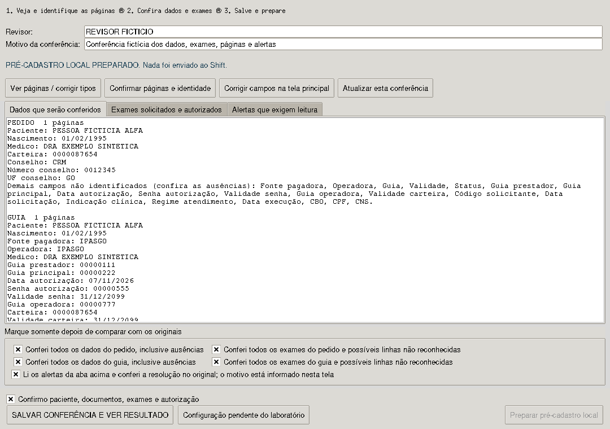

# Correção 2.4.5 — pedido carimbado e conclusão da conferência

A versão 2.4.4 foi preservada em ZIP e na branch `entrega/shift-v2.4.4`. Antes de modificar o código, seus 225 testes passaram novamente. Esta rodada utiliza exclusivamente documentos inteiramente fictícios; o programa existente continua sendo a base.

## Falhas reproduzidas

1. Uma folha com cabeçalho de clínica, paciente, cinco exames e carimbo azul “Dra. EXEMPLO SINTETICA / CRM-GO 0012345”, sem título “Pedido médico”, era classificada como incerta. O CRM era lido, mas o nome da médica ficava vazio; sem catálogo, os exames da lista não apareciam.
2. `App.import_scans()` reaplicava o tipo antigo a todas as páginas no reprocessamento, inclusive quando o tipo vinha de uma classificação automática nunca confirmada. A nova análise não corrigia essas fichas.
3. O revisor ficava no topo, o motivo era solicitado numa janela separada e a validação devolvia uma mensagem genérica sem apontar o campo. O botão desabilitado de pré-cadastro não explicava o bloqueio.
4. A conferência exigia navegar por várias abas, caixas de campos e alertas. A confirmação de agrupamento recarregava os visualizadores e perdia o conjunto de páginas já vistas, exigindo navegação repetida.
5. O nome do médico no carimbo podia conter “Dr./Dra.” enquanto a célula da guia trazia apenas o nome. A comparação exata criava divergência apesar do mesmo nome e dos demais identificadores.

## Mudanças no código

| Área | Funções e comportamento |
| --- | --- |
| Pedido com carimbo | `prescription_layout.evidence()` combina paciente, identificação profissional legível e lista de exames. `document_classification.classify_page()` usa essa evidência quando o título está ausente. Guias mantêm sua evidência estrutural; consentimento/receita e carimbo isolado não bastam para inferir pedido. |
| Campos e exames | `professional.free_identification()` associa nome impresso próximo ao carimbo ao CRM, com página/região e origem distinta. `engine_v2.parse_document()` conserva a lista impressa mesmo sem código interno. Só extrai quantidade efetivamente impressa; nunca fabrica TUSS, código Shift ou quantidade 1. |
| Reprocessamento | `scan_import.merge_reprocessed()` conserva distribuição de páginas, identificações corrigidas e classificações humanas explícitas; atualiza tipos automáticos antigos. Preserva nome original do arquivo e exige nova confirmação de agrupamento. |
| Revisor e motivo | `App.metadata_ready()` aponta o campo vazio, aplica destaque e foco, e abre a aba do motivo quando necessário. Os dois valores permanecem visíveis e são persistidos com a revisão local. Alterar o motivo após salvar exige novo salvamento. O motivo sugerido é editável, como era o texto inicial do diálogo anterior. |
| Botão bloqueado | O clique em Preparar bloqueado explica a ação necessária e pode levar diretamente ao revisor/motivo. `Por que está bloqueado?` oferece a mesma orientação de forma acessível. O botão não executa preparo nesse estado. |
| Páginas | `App.correct_page_type()` permite corrigir o tipo da miniatura selecionada sem reimportar. `confirm_case_pages()` confirma páginas e identidade com diálogo humano. `restore_seen_pages()` mantém a cobertura das páginas vistas durante essa atualização; não marca a revisão clínica automaticamente. |
| Conferência guiada | `assisted_review.ReviewAssistant` reúne revisor/motivo, resumo de dados, tabela de exames e alertas numa janela. O resumo destaca valores e campos principais e agrupa os demais ausentes. As confirmações humanas de dados, exames e alertas são explícitas. Só depois disso salva e apresenta o resultado. |
| Médico | `compare_tiss()` normaliza somente o tratamento Dr./Dra. para comparar nomes. Nomes diferentes e divergências de CRM/UF continuam bloqueados. Não preenche GO por frequência de uso. |

Não foram removidos `compare_models()`, `review_errors()`, regras de fonte pagadora, checagens de identidade/autorização, confirmação final nem proteção contra duplicidade. A janela guiada não ignora os validadores. Quantidade autorizada zero, ausência de dados essenciais e configuração não homologada continuam impedindo o preparo.

## Como o fluxo ficou

Importar → ver todas as páginas → corrigir tipos, se necessário → confirmar páginas/identidade → **CONFERIR ATENDIMENTO** → revisar Dados/Exames/Alertas → marcar as conferências realizadas → **SALVAR CONFERÊNCIA E VER RESULTADO**.

O resultado distingue:

- **Conferência salva sem pendências:** ainda exige confirmação humana final para preparar o pré-cadastro local.
- **Conferência salva com pendências:** lista o que impede o preparo, mantendo a revisão salva. Catálogo, código interno e perfil homologado são configurações do laboratório; não são substituídos por códigos de demonstração na rotina.

A demonstração antiga continua disponível. Em instalação separada e vazia, **Exemplos fictícios → primeira ficha → CONFERIR ATENDIMENTO** permite exercitar o preparo local sem configurar ou acessar o Shift real. Esse caminho também possui teste gráfico.

## Evidências dos testes

O relatório `RESULTADO_TESTES_2_4_5.txt` registra a suíte completa, a base antes das alterações e os limites de execução. Os novos testes cobrem pedido sem título com carimbo, guia que também tem carimbo, consentimento/receita, ausência de carimbo, quantidades ausentes, ordem invertida, quatro páginas, OCR de pedido girado e reprocessamento automático versus correção humana.

Os testes da interface reproduzem especificamente a mensagem informada pelo usuário: revisor vazio e motivo vazio. Verificam o foco no campo correto, a abertura da aba correspondente, a ausência de salvamento inválido e o clique no botão de pré-cadastro bloqueado. Também testam o fluxo guiado até `PREPARADO`, o motivo alterado após salvar, o exemplo fictício e os bloqueios por autorização zero e falta de catálogo.

`RELATORIO_CARIMBO_2_4_5.json` contém valores esperados/encontrados e suas origens. `RELATORIO_INTERFACE_2_4_5.json` registra importação, widgets, foco, revisão salva, liberação após confirmação, persistência de revisor/motivo e ausência de O.S. real. A captura mostra somente uma pessoa e documentos fictícios.

## Limitações restantes

- A execução nativa no Windows e o desempenho no computador do usuário continuam pendentes. Os testes foram executados em Linux com Tkinter, Tesseract por/eng e navegador simulado local.
- Carimbo precisa conter texto legível. Assinatura manuscrita, exames ilegíveis ou layouts fora dos exemplos podem continuar incertos. Não se afirma acerto de qualquer pedido real.
- A regra sem título usa evidências conservadoras de lista/paciente/carimbo; não é um classificador clínico universal. A correção manual continua disponível.
- Tipos previamente confirmados por uma pessoa são preservados no reprocessamento. Se a confirmação antiga estava errada, corrija o tipo da página uma vez.
- Identificação suficiente, códigos internos, catálogo, perfis e autorização válida continuam necessários ao preparo. A conferência pode ser salva sem que o atendimento esteja pronto para cadastro.
- Todo processamento é local. Nenhum documento clínico foi enviado, nenhum Shift real foi acessado, nenhuma O.S. real foi criada e nenhuma etiqueta oficial foi impressa.

Passo a passo para iniciantes: `ATUALIZAR_PARA_2_4_5.txt`.
